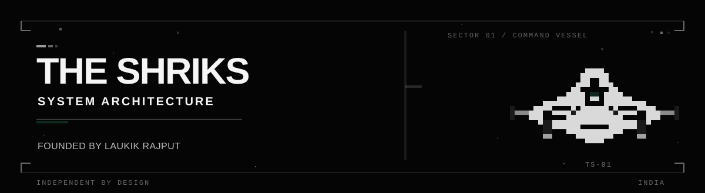

<div align="center">
  
</div>

## THE SHRIKS

India-based technology venture working across **system architecture, custom engineering, AI systems, software infrastructure, owned products, and media IP**.

Founded and led by **Laukik Rajput**.

### 01 / Directions

- **SylvieAI**  
  Customer signals into verified product and engineering action.

- **LokiAI**  
  AI-operated physical and edge systems.

- **ENMAS**  
  Original worlds, media IP, and creative systems.

- **SAAR**  
  Local-first financial intelligence workspace.

### 02 / Selected work

- **[SAAR](https://github.com/THE-SHRIKS/SAAR-LokiXPiyush)**  
  Local financial records, reconciliation, and grounded interaction.

- **[Open Lite Discord](https://github.com/THE-SHRIKS/Open-Lite-Discord)**  
  Reconstructing a local-first communication core.

- **[ENMAS](https://github.com/THE-SHRIKS/ENMAS)**  
  Interactive worlds and editorial media surfaces.

### 03 / Principles

```text
ARCHITECTURE   Understand the system before multiplying its parts.
ENGINEERING    Design for the constraints that actually exist.
VERIFICATION   Build, test, inspect, repeat.
OWNERSHIP      Make useful systems, not disposable noise.
