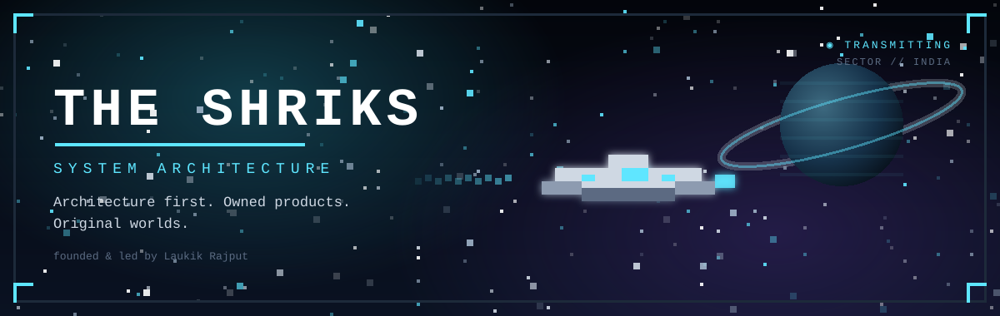
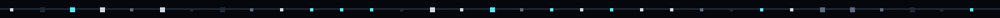
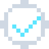
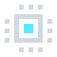
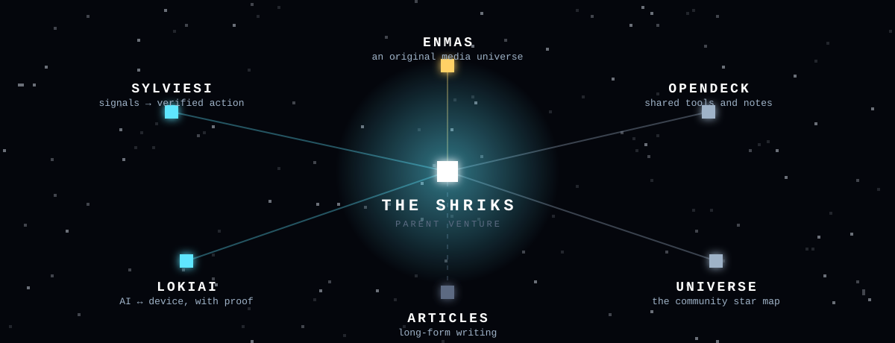

 

**A technology venture from India.** 
We design systems, build owned products, and create original worlds.

✦ architecture first &nbsp;·&nbsp; evidence over demos &nbsp;·&nbsp; original IP beside honest engineering ✦

  

[**🌐 theshriks.space**](https://www.theshriks.space) &nbsp;·&nbsp; [**𝕏 @THESHRIKS**](https://x.com/THESHRIKS)

 

## 🛰️ &nbsp;The Fleet

<table>
<tr>
<td align="center" width="33%" valign="top">
 
<h3><a href="https://sylviesi.theshriks.space">SylvieSI</a></h3>
Customer signals, turned into **verified** product and engineering action.
  
<code>● in active build</code>
</td>
<td align="center" width="33%" valign="top">
 
<h3><a href="https://lokiai.theshriks.space">LokiAI</a></h3>
A constrained, verifiable runtime for AI that operates **physical and edge devices**. First proof target: ESP32-S3.
  
<code>● in active engineering</code>
</td>
<td align="center" width="33%" valign="top">
 
<h3><a href="https://enmas.theshriks.space">ENMAS</a></h3>
An original, AI-native **media universe**. Three characters — SERA, AIZEN, MAVERICK — and the worlds they inhabit.
  
<code>✦ its own universe</code>
</td>
</tr>
</table>

 

## 🌌 &nbsp;The Constellation

 

## 📡 &nbsp;Mission Log

> **Architecture before implementation.** Every decision names its constraints, its state, and what happens when it fails.

> **Evidence over demos.** A claim earns its place with a test, a log or a link. Things that only *look* working don't count.

> **Owned products and original IP**, alongside selected engineering work for other teams.

> **AI proposes; systems and people decide.** Nothing changes the outside world without a recorded approval.

> **Honest status.** *Built*, *tested* and *live* are three different words here. We use each one carefully.

 

## 🛸 &nbsp;Reach Us

| | |
|---|---|
| **Engineering inquiries** | [theshriks.space](https://www.theshriks.space) |
| **Follow the signal** | [@THESHRIKS on X](https://x.com/THESHRIKS) |
| **Founder** | Laukik Rajput |

 

THE SHRIKS &nbsp;·&nbsp; architected in India &nbsp;·&nbsp; transmitting from the pixel frontier ✦

