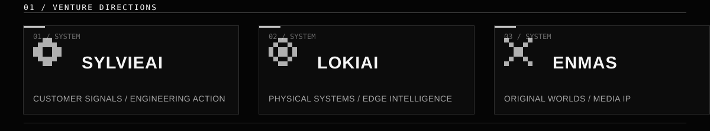
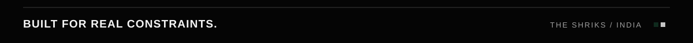

  

 

**THE SHRIKS** is an India-based technology venture working across system architecture, custom engineering, AI, software infrastructure, owned products, and original media.

**Founder:** Laukik Rajput

 

  

SylvieAI turns customer signals into verified engineering action. LokiAI explores intelligent physical and edge systems. ENMAS develops original worlds and creative technology.

 

  

| PROJECT | ENGINEERING DIRECTION |
| :--- | :--- |
| [**SAAR**](https://github.com/THE-SHRIKS/SAAR-LokiXPiyush) | A privacy-first, local financial workspace for document analysis and reconciliation. |
| [**Open Lite Discord**](https://github.com/THE-SHRIKS/Open-Lite-Discord) | Exploring the architecture of local-first, real-time communication. |
| [**ENMAS**](https://github.com/THE-SHRIKS/ENMAS) | Engineering the interactive environments behind an original media universe. |

Design for real constraints. Verify the results. Keep the architecture legible.

 

**[Website](https://theshriks.space)** &nbsp; / &nbsp; **[Repositories](https://github.com/THE-SHRIKS?tab=repositories)** &nbsp; / &nbsp; **[X](https://x.com/THESHRIKS)**

  

