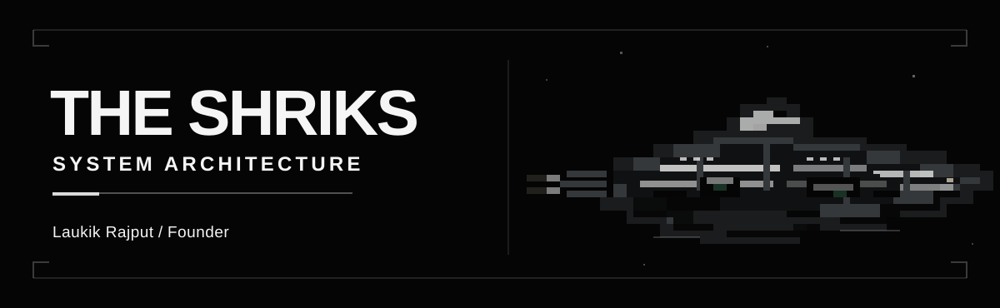
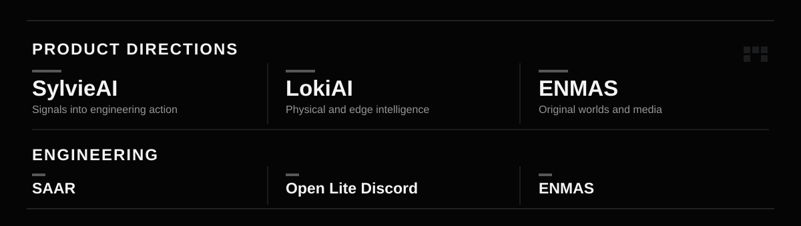

  

 

**THE SHRIKS** is a technology venture founded by **Laukik Rajput**. We work across system architecture, custom engineering, AI, software infrastructure, and original media.

 

  

  <a href="https://github.com/THE-SHRIKS/SAAR-LokiXPiyush">SAAR</a>
  &nbsp; / &nbsp;
  <a href="https://github.com/THE-SHRIKS/Open-Lite-Discord">Open Lite Discord</a>
  &nbsp; / &nbsp;
  <a href="https://github.com/THE-SHRIKS/ENMAS">ENMAS</a>

 

  <a href="https://theshriks.space">Website</a>
  &nbsp; · &nbsp;
  <a href="https://github.com/THE-SHRIKS?tab=repositories">Repositories</a>
  &nbsp; · &nbsp;
  <a href="https://x.com/THESHRIKS">X</a>

